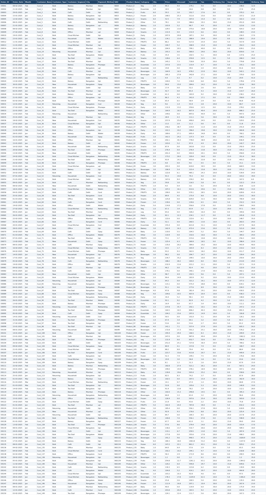
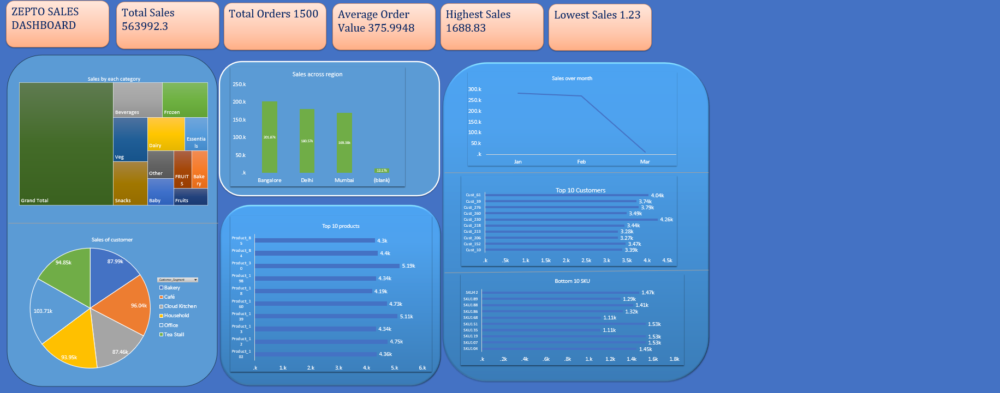
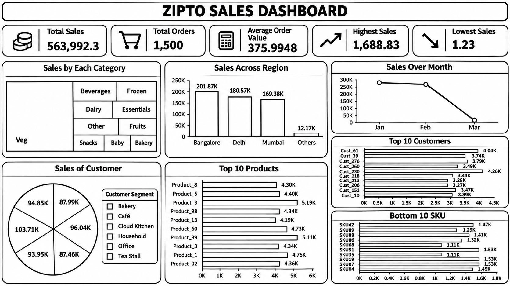

# zeptosalesdashboer
Zepto Sales Dashboard is an Excel-based data analytics project that tracks sales performance through key KPIs: Total Sales, Total Orders, Average Order Value, Highest Sales, and Lowest Sales. It also presents category-wise, region-wise, and monthly sales, top 10 products, top 10 customers, and bottom 10 SKUs through clear charts and visualizations. 
# Project Title 
Zepto Sales Analysis Dashboard using Microsoft Excel 
# Project Overview 
Zepto is a quick-commerce platform that delivers groceries and daily essentials within minutes. 
Every day, thousands of customer transactions are generated, making sales analysis essential for 
understanding business performance. 
This project analyzes Zepto sales data using Microsoft Excel. The dashboard provides insights 
into sales, product categories, customer purchasing behavior, and monthly trends. By using Pivot 
Tables, Pivot Charts, and Slicers, the dashboard enables interactive analysis that helps businesses 
make informed decisions. 
# Objectives 
* Analyze overall sales performance. 
* Compare sales across product categories and sub-categories. 
* Identify fast-selling and slow-selling products. 
* Study customer purchasing behavior. 
* Analyze monthly sales trends. 
* Build an interactive dashboard for business decision-making. 
# Dataset Information 
The dataset contains sales transaction records collected from Zepto’s operations. 
### Important Columns 
* Order ID 
* Order Date 
* Product Name 
* Category 
* Sub-Category 
* Customer Name/ID 
* Quantity 
* Unit Price 
* Total Sales 
* Discount 
* Profit 
* City/Location

These fields help analyze sales performance, customer trends, and inventory movement. 

# Tools Used 
Microsoft Excel: 
*Used for data analysis and dashboard creation. 
Pivot Tables: 
*Summarize large amounts of sales data. 
Pivot Charts: 
*Visualize sales trends and category performance. 
Slicers: 
*Allow users to filter data interactively. 
Conditional Formatting: 
*Highlights important values such as top-performing products. 
# Data Cleaning Process 
Before analysis, the dataset was cleaned to improve accuracy. 
### Data Cleaning Steps 
1. Removed Duplicate Records 
* Deleted repeated sales transactions. 
2. Handled Missing Values 
* Checked for blank cells. 
* Filled or removed incomplete records. 
3. Standardized Data 
* Ensured consistent spelling for categories and products. 
* Converted dates into a uniform format. 
4. Checked Data Types 
* Sales and Quantity stored as numeric values. 
* Dates stored correctly. 
5. Validated Data 
* Removed incorrect or negative values. 
* Verified totals and calculations. 
Data cleaning ensures reliable and accurate analysis. 
# Dashboard Features 
The Excel dashboard contains several interactive visualizations. 
### Key Performance Indicators (KPIs) 
* Total Sales 
* Total Orders 
* Total Quantity Sold 
* Total Profit 
* Average Order Value 
### Dashboard Components 
* Sales by Category:Shows revenue generated by each product category. 
* Monthly Sales Trend:Displays sales growth or decline over different months. 
* Top Selling Products:Highlights products with the highest sales. 
* Customer Analysis:Identifies valuable customers based on purchase amount.
 ## Dashboard
 
 ## Dashboard sketching
  
### Interactive Filters 
Users can filter the dashboard by: 
* Category 
* Product 
* Month 
* Customer 
These features make the dashboard easy to explore and analyze. 
# Key Insights 
• From the dashboard, several business insights were identified. 
1. Best Performing Categories 
Some product categories contribute more revenue than others. 
2. Monthly Sales Trend 
Sales vary across different months, indicating seasonal demand. 
3. Fast-Moving Products 
Products with high sales should always remain in stock. 
4. Slow-Moving Products 
Products with low sales may require discounts or promotional offers. 
5. Customer Purchasing Behavior 
Frequent customers contribute significantly to overall revenue. 
6. Business Benefits 
* Better inventory planning 
* Improved sales forecasting 
* Better marketing decisions 
* Increased customer satisfaction 
# Conclusion 
The Zepto Sales Analysis Dashboard successfully analyzes sales performance using Microsoft 
Excel. It provides valuable insights into product performance, customer behavior, and sales 
trends through interactive charts and KPIs. 
The dashboard enables management to make data-driven decisions regarding inventory, pricing, 
marketing strategies, and business growth. [click here to view data file](zepto_sales_raw.xlsx)
